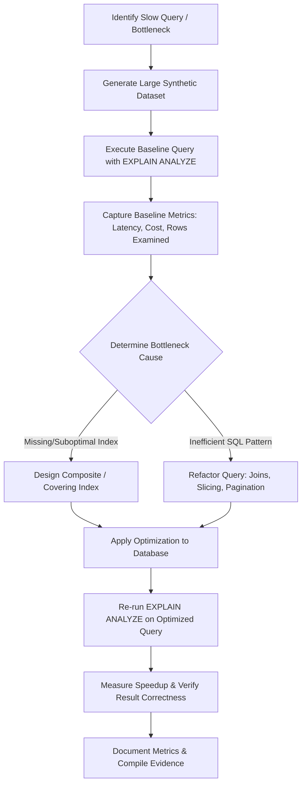

# Portfolio 2: Query Optimisation

**Course:** MIT8103 — Advanced Database Systems  
**Student Name:** Mary Okwusogu  
**Student ID:** 301903956  
**Institution:** Miva Open University  
**Case Study Application:** BlitzFintech Performance Engineering  
**Primary Database Engine:** MySQL 8.x (InnoDB Engine)  
**Status:** Planned / In Progress *(Documentation and Roadmap Phase)*  

---

## 1. Executive Summary & Objectives

Portfolio 2 focuses on **Query Optimisation and Performance Engineering** within relational database systems, building directly upon the BlitzFintech schema designed and implemented in Portfolio 1. As transaction volumes and customer records scale into millions of rows, naive SQL queries lead to full table scans, buffer pool contention, high query latency, and system bottlenecks.

### Key Objectives
1. **Query Profiling & Execution Plan Analysis:** Deconstruct relational query execution paths using `EXPLAIN`, `EXPLAIN ANALYZE`, and the MySQL Workbench Visual Explain tool to diagnose bottlenecks (table scans, index scans, temporary tables, filesorts).
2. **Indexing Strategies & Data Structure Engineering:** Design, benchmark, and evaluate B-Tree indexing techniques—including single-column indexes, composite (multi-column) indexes, covering indexes, and prefix indexes—based on column cardinality and selectivity.
3. **Query Refactoring & Algorithmic Optimisation:** Rewrite suboptimal SQL constructs (e.g., correlated subqueries vs. explicit `INNER/LEFT JOIN`s, `OR` clauses vs. `UNION ALL`, and `OFFSET/LIMIT` vs. keyset/cursor-based pagination).
4. **Empirical Benchmarking & Metrics:** Measure latency (execution time in milliseconds), cost metrics, buffer pool logical/physical reads, and rows examined versus rows returned before and after optimisation.
5. **Trade-off Evaluation:** Analyze the operational costs of indexing, including storage footprint and DML insert/update throughput degradation.

---

## 2. Scope & Target Workloads

The optimization study will evaluate high-frequency and compute-intensive operational and analytical queries on the BlitzFintech database:

1. **High-Volume Ledger Auditing:** Filtering and sorting millions of `ledger_entry` records by account and date range to compute running balances and statements.
2. **Customer Compliance & Risk Aggregation:** Complex multi-table joins linking `customer`, `kyc_case`, `customer_document`, and `account` to identify high-risk accounts with expired documentation.
3. **Multi-Party Mandate Authorization Verification:** Time-sensitive queries checking active signatories and transaction limits before approving large financial transactions.
4. **Idempotency Deduplication Lookup:** Microsecond-latency primary lookup on `idempotency_request(idempotency_key)` under concurrent API traffic.
5. **System-Wide Audit Event Slicing:** Querying `audit_log` across JSON attributes and temporal windows for forensic analysis.

---

## 3. Directory Structure (Planned Architecture)

To maintain consistency across the MIT8103 portfolio repository, this portfolio is organised as follows:

```
portfolio-2-query-optimisation/
├── 01-documentation/
│   ├── query-optimisation-report.docx             # Planned comprehensive academic report
│   └── profiling-methodology.md                   # Technical profiling guidelines & metrics
├── 02-baseline-queries/
│   ├── 01-unindexed-workload.sql                  # Baseline queries executed without optimization
│   └── 02-baseline-explain-plans.md               # Baseline EXPLAIN and EXPLAIN ANALYZE outputs
├── 03-optimisation-implementation/
│   ├── 01-index-creation.sql                      # DDL scripts adding composite & covering indexes
│   ├── 02-refactored-queries.sql                  # Optimized and refactored SQL queries
│   └── 03-stored-procedures.sql                  # Optimized procedural query patterns
├── 04-benchmarks-and-evidence/
│   ├── benchmark-results.xlsx                     # Comparative metrics (execution time, cost, I/O)
│   ├── visual-explain-diagrams/                   # Graphical query execution tree comparisons
│   └── screenshot-evidence.docx                   # Documented screenshot evidence of execution
└── README.md                                      # Portfolio overview (this document)
```

> **Implementation Note:** This directory is currently initialized with the architectural specification and methodology. Implementation SQL scripts, synthetic load generators, and benchmark measurements will be populated during the active testing phase.

---

## 4. Planned File Inventory & Descriptions

### Documentation (`01-documentation/`)
- `query-optimisation-report.docx`: Detailed academic report evaluating MySQL cost-based optimizer (CBO) decisions, execution algorithms (Nested Loop Join, Block Nested Loop, Hash Join), index internals, and quantitative benchmark results.
- `profiling-methodology.md`: Measurement methodology defining warm vs. cold cache execution, MySQL `sys` schema monitoring, buffer pool flushing (`RESET QUERY CACHE;`), and precision timing.

### Baseline Workloads (`02-baseline-queries/`)
- `01-unindexed-workload.sql`: Test suite of 5–8 unoptimized queries running against large synthetic datasets (100,000+ customer and ledger rows), exhibiting table scans and temporary tables.
- `02-baseline-explain-plans.md`: Raw textual and JSON execution plans capturing baseline cost metrics, access types (`ALL`, `index`, `range`), and estimated row examinations.

### Optimization Implementation (`03-optimisation-implementation/`)
- `01-index-creation.sql`: Targeted DDL script introducing composite indexes (e.g., `(account_id, created_at, entry_type)`), covering indexes containing projection columns, and prefix indexes for text fields.
- `02-refactored-queries.sql`: Rewritten SQL scripts replacing anti-patterns (e.g., eliminating `SELECT *`, replacing `NOT IN (SELECT...)` with `NOT EXISTS` or `LEFT JOIN ... WHERE IS NULL`, implementing seek-based pagination).
- `03-stored-procedures.sql`: Parameterized routines demonstrating optimized execution plans and plan caching.

### Benchmarks & Evidence (`04-benchmarks-and-evidence/`)
- `benchmark-results.xlsx`: Comparative matrix tabulating:
  - Query ID and description
  - Baseline execution time (ms) vs. Optimized execution time (ms)
  - Rows examined vs. Rows returned
  - Optimizer cost units
  - Index storage overhead (MB)
  - Percentage speedup calculation
- `visual-explain-diagrams/`: Visual Explain screenshots illustrating the transition from costly full-table scans to indexed range scans.
- `screenshot-evidence.docx`: Academic evidence document compiling screenshots of MySQL Workbench query executions, execution plans, and performance schema metrics.

---

## 5. Technology Stack & Tooling

- **DBMS Platform:** MySQL Community Server 8.0.x / 8.4 LTS
- **Storage Engine:** InnoDB (B-Tree clustered primary indexes, secondary indexes, adaptive hash indexing)
- **Profiling Tools:**
  - `EXPLAIN FORMAT=JSON` / `EXPLAIN FORMAT=TREE`
  - `EXPLAIN ANALYZE` (MySQL 8.0.18+) providing actual vs. estimated row counts and execution timing
  - MySQL `Performance Schema` and `sys.statement_analysis`
  - MySQL Workbench Visual Explain
- **Data Generation:** Synthetic data scaling scripts generating realistic data volume with controlled cardinality.

---

## 6. Optimization Methodology & Implementation Steps



### Planned Implementation Phases
1. **Workload Synthesis:** Expand Portfolio 1 test datasets using synthetic generator scripts to produce 50,000–500,000 records across `financial_transaction`, `ledger_entry`, and `customer_document`.
2. **Diagnostic Profiling:** Execute each baseline query and analyze:
   - Access Type: Flagging `ALL` (full table scan) and `index` (full index scan).
   - Key Used: Verifying whether the optimizer selected the expected index.
   - Extra Information: Flagging `Using temporary`, `Using filesort`, and `Using where`.
3. **Index Engineering:**
   - Implement Leftmost Prefix Rule on composite keys.
   - Deploy covering indexes to enable index-only scans without secondary lookup back to the clustered primary key table.
4. **Verification & Regression Testing:** Validate that the optimized queries return identical result sets to baseline queries to ensure functional correctness.
5. **Benchmarking & Documentation:** Quantify performance deltas across repeated runs to account for cache warm-up and compile the academic report.

---

## 7. Current Status & Deliverable Tracking

| Phase / Deliverable | Status | Target Completion | Evidence / Artifact |
|---|---|---|---|
| Portfolio Scope & Architecture | **Completed** | Milestone 1 | `README.md` (this file) |
| Synthetic Dataset Scaler Script | Planned | Milestone 2 | `02-baseline-queries/` |
| Baseline Workload & EXPLAIN Capture | Planned | Milestone 2 | `02-baseline-queries/` |
| Index DDL & Refactored SQL Suite | Planned | Milestone 3 | `03-optimisation-implementation/` |
| Comparative Benchmark Spreadsheet | Planned | Milestone 4 | `04-benchmarks-and-evidence/` |
| Formal Academic Report & Evidence DOCX | Planned | Milestone 4 | `01-documentation/` |

---

## 8. Limitations & Engineering Considerations

- **Buffer Pool Influences:** Repeated queries in a single session benefit from the InnoDB Buffer Pool. Benchmarks must differentiate between cold-start physical disk reads and warm-cache in-memory reads.
- **Index Write Overhead:** While secondary indexes dramatically accelerate read latency (`SELECT`), each added index incurs write amplification on `INSERT`, `UPDATE`, and `DELETE` operations. This trade-off must be measured and documented.
- **Data Skew & Selectivity:** Cardinality dictates optimizer choices. Low-cardinality columns (e.g., `party_type` with 2 values) will typically result in index bypass by the optimizer in favor of a table scan.

---

## 9. References & Standards

1. Oracle Corporation (2024). *MySQL 8.0 Reference Manual: Optimization and Indexes*. Available at: https://dev.mysql.com/doc/refman/8.0/en/optimization.html.
2. Winand, M. (2012). *SQL Performance Explained*. Vienna: Markus Winand.
3. Schwartz, B. (2022). *High Performance MySQL: Proven Strategies for Operating at Scale*. 4th edn. Sebastopol, CA: O'Reilly Media.
4. Graefe, G. (2011). 'Modern B-Tree Techniques'. *Foundations and Trends in Databases*, 3(4), pp. 203–402.
