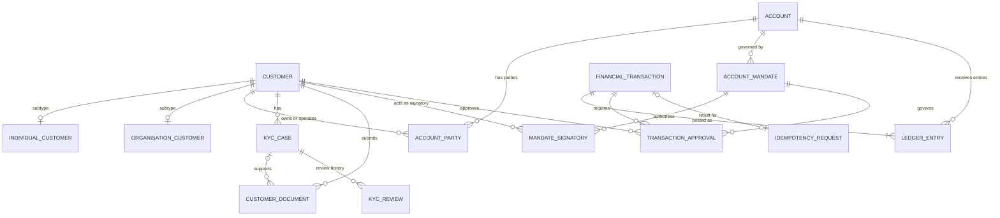

# Portfolio 1: Relational Database Design and Implementation

**Course:** MIT8103 — Advanced Database Systems  
**Student Name:** Mary Okwusogu  
**Student ID:** 301903956  
**Institution:** Miva Open University  
**Case Study:** BlitzFintech Electronic Financial Services Platform  
**Primary Database Engine:** MySQL 8.x with InnoDB  
**Status:** Completed and Validated  

---

## 1. Executive Summary & Objectives

Portfolio 1 establishes the relational database architectural foundation for **BlitzFintech**, a digital financial services provider. The platform models customer onboarding, identity verification (KYC), account management, multi-party account ownership, signing mandates, double-entry financial ledger operations, and comprehensive auditing.

### Key Objectives
1. **Conceptual and Logical Modelling:** Translate real-world fintech business operations into a normalized relational model (targeting Third Normal Form, 3NF).
2. **Defensive Schema Design:** Implement robust data integrity mechanisms using MySQL 8.x InnoDB, including primary keys, foreign keys with referential actions (`ON DELETE RESTRICT`), unique constraints, nullability rules, check constraints, and performance indexes.
3. **Financial Precision & Integrity:** Enforce exact arithmetic using `DECIMAL(19,4)` for monetary values, avoiding floating-point inaccuracies, and establishing a double-entry ledger architecture.
4. **Empirical Validation:** Execute positive test scenarios and negative constraint violation tests to prove schema enforcement, verify transaction rollback mechanisms, and confirm zero referential orphans or unbalanced ledger records.
5. **Comprehensive Evidence Collection:** Compile academic documentation, ER diagrams, data dictionaries, and screenshot evidence of database creation, data enrichment, and test execution.

---

## 2. Business Context & Case Study (BlitzFintech)

BlitzFintech provides electronic financial accounts to individual retail customers and corporate entities. The operational model requires strict separation of concerns:
- **Customer Identity & KYC:** Onboarding requires distinct profiles for individuals (national identity, date of birth) and organisations (company registration numbers, country of incorporation), alongside KYC cases and supporting documents (passports, utility bills) verified by compliance staff.
- **Account Governance & Mandates:** Accounts support single or joint ownership. Corporate accounts can define operational mandates with required approval counts and authorized signatories holding explicit monetary limits.
- **Financial Processing:** Financial transactions (deposits, withdrawals, transfers) are recorded as high-level transaction headers and mapped to atomic double-entry ledger postings (`DEBIT` and `CREDIT`).
- **Idempotency & Auditing:** To prevent duplicate debiting on network retries, transactions support idempotency keys. All security-sensitive actions and record modifications are captured in an audit log with temporal metadata and structured JSON snapshots.

---

## 3. Directory Structure

The portfolio is structured into three dedicated directories:

```
Okwusogu_Mary_301903956_portfolio_1_database_design/
├── Okwusogu_Mary_301903956_01_documentation/
│   └── Okwusogu_Mary_301903956_portfolio1_report.docx                     # Formal academic report
├── Okwusogu_Mary_301903956_02_design/
│   ├── Okwusogu_Mary_301903956_business_rules.md                          # 52 formal business rules register
│   ├── Okwusogu_Mary_301903956_erd.mmd                                    # Mermaid.js ER diagram source
│   ├── Okwusogu_Mary_301903956_ERD.png                                    # High-resolution visual ERD
│   ├── Okwusogu_Mary_301903956_normalisation.md                           # 1NF, 2NF, 3NF normalisation rationale
│   ├── Okwusogu_Mary_301903956_relational_schema.md                       # Comprehensive data dictionary
│   └── Okwusogu_Mary_301903956_Summary.xlsx                               # Entity relationship matrix
├── Okwusogu_Mary_301903956_03_sql/
│   ├── Okwusogu_Mary_301903956_01_create_database.sql                     # Database & engine initialization
│   ├── Okwusogu_Mary_301903956_02_create_tables.sql                       # 13 DDL table definitions with constraints
│   ├── Okwusogu_Mary_301903956_03_constraints_and_indexes.sql             # Metadata & constraint verification
│   ├── Okwusogu_Mary_301903956_04_test_data.sql                           # Synthetic test data population
│   ├── Okwusogu_Mary_301903956_05_validation_tests.sql                    # Positive & negative constraint test suite
│   ├── Okwusogu_Mary_301903956_06_sample_queries.sql                      # Operational & analytical business queries
│   ├── Okwusogu_Mary_301903956_Constraint_Validation_Screenshots.docx     # Constraint test screenshots
│   ├── Okwusogu_Mary_301903956_Data_Enrichment_Screenshot_Evidence.docx    # Data enrichment screenshots
│   └── Okwusogu_Mary_301903956_Screenshot_Evidence.docx                   # End-to-end execution screenshots
└── Okwusogu_Mary_301903956_README.md                                      # Portfolio overview (this document)
```

---

## 4. File Inventory & Detailed Descriptions

### Documentation (`Okwusogu_Mary_301903956_01_documentation/`)
- [Okwusogu_Mary_301903956_portfolio1_report.docx](Okwusogu_Mary_301903956_01_documentation/Okwusogu_Mary_301903956_portfolio1_report.docx): The formal assessment report covering business context, data architecture (MySQL InnoDB, MongoDB architectural fit, secure object storage for binary files), relational design, normalisation analysis, transaction boundaries, security, and academic limitations.

### Design Artifacts (`Okwusogu_Mary_301903956_02_design/`)
- [Okwusogu_Mary_301903956_business_rules.md](Okwusogu_Mary_301903956_02_design/Okwusogu_Mary_301903956_business_rules.md): A formal catalogue of 52 business rules categorised into 6 operational areas:
  - **A. Customer and Identity (BR-001 – BR-007):** Supertype/subtype modeling, unique customer numbers, contact validation, soft-delete policies.
  - **B. Accounts and Ownership (BR-008 – BR-015):** Account statuses, currency requirements, joint ownership, balance validation, overdraft constraints.
  - **C. KYC and Documents (BR-016 – BR-023):** Case tracking, document metadata, expiry rules, reviewer attribution, binary storage offloading.
  - **D. Mandates and Signatories (BR-024 – BR-030):** Signing authorities, effective dates, approval thresholds, separation of duties.
  - **E. Financial Operations (BR-031 – BR-044):** Exact decimal arithmetic, atomic transfer postings, idempotency deduplication, immutable ledger entries, reversal procedures.
  - **F. Audit, Access, and Integrity (BR-045 – BR-052):** Least privilege, immutable audit logs, balance reconciliation.
- [Okwusogu_Mary_301903956_erd.mmd](Okwusogu_Mary_301903956_02_design/Okwusogu_Mary_301903956_erd.mmd): Textual Mermaid.js specification mapping all 13 entities and their relational cardinalities.
- [Okwusogu_Mary_301903956_ERD.png](Okwusogu_Mary_301903956_02_design/Okwusogu_Mary_301903956_ERD.png): High-resolution visual entity relationship diagram displaying primary keys, foreign keys, table columns, and cardinality connectors.
- [Okwusogu_Mary_301903956_Summary.xlsx](Okwusogu_Mary_301903956_02_design/Okwusogu_Mary_301903956_Summary.xlsx): Structured spreadsheet documenting parent/child relationships, cardinalities (`1:0..1`, `1:N`, `M:N`), foreign key mappings, and relationship narratives.
- [Okwusogu_Mary_301903956_normalisation.md](Okwusogu_Mary_301903956_02_design/Okwusogu_Mary_301903956_normalisation.md): Normalisation justification walking through 1NF (atomic columns, associative tables), 2NF (removal of partial dependencies via composite keys), and 3NF (transitive dependency removal via subtypes). Details the engineering trade-off of maintaining `account.balance` as a denormalised operational read cache alongside the immutable double-entry `ledger_entry` table.
- [Okwusogu_Mary_301903956_relational_schema.md](Okwusogu_Mary_301903956_02_design/Okwusogu_Mary_301903956_relational_schema.md): Complete technical data dictionary specifying table names, data types, primary keys, foreign keys, uniqueness constraints, nullability, and relationships across all 13 tables.

### SQL Scripts & Evidence (`Okwusogu_Mary_301903956_03_sql/`)
- [Okwusogu_Mary_301903956_01_create_database.sql](Okwusogu_Mary_301903956_03_sql/Okwusogu_Mary_301903956_01_create_database.sql): Creates `blitzfintech_db` with `utf8mb4` character set and `utf8mb4_0900_ai_ci` collation, and sets the session default engine to InnoDB.
- [Okwusogu_Mary_301903956_02_create_tables.sql](Okwusogu_Mary_301903956_03_sql/Okwusogu_Mary_301903956_02_create_tables.sql): Complete DDL script creating all 13 tables:
  1. `customer`: Common identity, contact, customer status, KYC status, and risk rating.
  2. `individual_customer`: Subtype for individual retail customers (`date_of_birth`, `identity_country`).
  3. `organisation_customer`: Subtype for legal entities (`registration_number`, `registration_country`, `incorporated_at`).
  4. `account`: Core account records with status, currency, and balance (`DECIMAL(19,4)`).
  5. `account_party`: Resolves M:N customer-to-account relationships with roles (`HOLDER`, `JOINT_HOLDER`, `BENEFICIAL_OWNER`, `SIGNATORY`).
  6. `kyc_case`: Compliance workflow cases (`ONBOARDING`, `PERIODIC_REVIEW`, `EVENT_DRIVEN`).
  7. `customer_document`: Metadata, storage keys, SHA-256 checksums, and verification status for compliance documents.
  8. `kyc_review`: Audit log of reviewer decisions (`APPROVED`, `REJECTED`, `MORE_INFO`).
  9. `account_mandate`: Account operating rules, effective dates, and required approval counts.
  10. `mandate_signatory`: Authorized individual signatories and individual transaction spending limits.
  11. `financial_transaction`: Transaction headers (`DEPOSIT`, `WITHDRAWAL`, `TRANSFER`, `REVERSAL`), amounts, idempotency keys, and statuses.
  12. `ledger_entry`: Double-entry financial journal lines (`DEBIT`, `CREDIT`) linked to accounts and transactions.
  13. `transaction_approval`: Dual-control approval decisions by authorized signatories.
  14. `idempotency_request`: Request deduplication cache storing idempotency keys and SHA-256 request payload hashes.
  15. `audit_log`: System-wide temporal audit trail capturing actor, entity, action, and JSON change payloads.
- [Okwusogu_Mary_301903956_03_constraints_and_indexes.sql](Okwusogu_Mary_301903956_03_sql/Okwusogu_Mary_301903956_03_constraints_and_indexes.sql): Safe post-creation verification script inspecting `information_schema.TABLES` and `TABLE_CONSTRAINTS`.
- [Okwusogu_Mary_301903956_04_test_data.sql](Okwusogu_Mary_301903956_03_sql/Okwusogu_Mary_301903956_04_test_data.sql): Populates synthetic test data (individuals `BF-TEST-C001`/`C002`, organisation `BF-TEST-C003`, savings accounts `BF-TEST-A001`/`A002`, mandates, signatories, and transactions).
- [Okwusogu_Mary_301903956_05_validation_tests.sql](Okwusogu_Mary_301903956_03_sql/Okwusogu_Mary_301903956_05_validation_tests.sql): Rigorous test harness featuring:
  - **Positive Checks:** Validating 100% InnoDB engine adoption, zero duplicate customer numbers, zero duplicate transaction references.
  - **Negative Tests:** Deliberate constraint violation tests validating rejection of duplicate PKs/UKs, `NULL` values in mandatory columns, invalid check constraint values (`party_type`, negative balances, zero transaction amount, invalid ledger entry types), and invalid foreign keys.
  - **Transaction Rollback Test:** Demonstrating atomic rollback of uncommitted balance changes within a `START TRANSACTION ... ROLLBACK` block.
  - **Integrity Audits:** Queries verifying zero orphaned `account_party` records and verifying ledger reconciliation (zero unbalanced debit/credit transactions).
- [Okwusogu_Mary_301903956_06_sample_queries.sql](Okwusogu_Mary_301903956_03_sql/Okwusogu_Mary_301903956_06_sample_queries.sql): 7 production-realistic analytical queries demonstrating customer status reviews, joint account mapping, expiring KYC documents, ledger history, upcoming mandate expirations, and audit log analysis.
- [Okwusogu_Mary_301903956_Constraint_Validation_Screenshots.docx](Okwusogu_Mary_301903956_03_sql/Okwusogu_Mary_301903956_Constraint_Validation_Screenshots.docx): Evidence document containing 19 embedded screenshot exhibits demonstrating validation of primary keys, foreign keys, unique constraints, InnoDB engine verification, and customer subtypes.
- [Okwusogu_Mary_301903956_Data_Enrichment_Screenshot_Evidence.docx](Okwusogu_Mary_301903956_03_sql/Okwusogu_Mary_301903956_Data_Enrichment_Screenshot_Evidence.docx): Evidence document containing 25 embedded screenshot exhibits showing test data insertion and data enrichment across all entities.
- [Okwusogu_Mary_301903956_Screenshot_Evidence.docx](Okwusogu_Mary_301903956_03_sql/Okwusogu_Mary_301903956_Screenshot_Evidence.docx): Comprehensive evidence document containing 28 embedded screenshot exhibits showing end-to-end MySQL Workbench script execution and query outputs.

---

## 5. Relational Architecture & Entity-Relationship Summary

The data model is expressed in the following entity relationship model:



### Table Summary Matrix

| Table Name | Primary Key | Key Foreign Keys | Purpose & Core Constraints |
|---|---|---|---|
| `customer` | `customer_id` (PK) | None | Core party record. Unique `customer_number`, unique `email`. Checks on `party_type`, `customer_status`, `kyc_status`, `risk_rating`. |
| `individual_customer` | `customer_id` (PK) | `customer(customer_id)` | Retail customer attributes (`date_of_birth`, `identity_country`). `ON DELETE RESTRICT`. |
| `organisation_customer` | `customer_id` (PK) | `customer(customer_id)` | Corporate entity attributes (`registration_number`, `registration_country`, `incorporated_at`). |
| `account` | `account_id` (PK) | None | Bank account record. Unique `account_number`. Checks: `balance >= 0`, `account_type`, `account_status`. |
| `account_party` | `(account_id, customer_id, party_role)` (Composite PK) | `account`, `customer` | Resolves M:N relationship. Captures roles (`HOLDER`, `JOINT_HOLDER`, `BENEFICIAL_OWNER`, `SIGNATORY`). |
| `kyc_case` | `kyc_case_id` (PK) | `customer(customer_id)` | KYC workflow lifecycle container (`ONBOARDING`, `PERIODIC_REVIEW`, `EVENT_DRIVEN`). |
| `customer_document` | `document_id` (PK) | `customer`, `kyc_case` | Metadata for uploaded identity/compliance documents. Stores SHA-256 hash and object key. |
| `kyc_review` | `kyc_review_id` (PK) | `kyc_case(kyc_case_id)` | Review log capturing compliance reviewer decision and reasoning. |
| `account_mandate` | `mandate_id` (PK) | `account(account_id)` | Operational rules, required approvals count (`>= 1`), and validity date range (`effective_to >= effective_from`). |
| `mandate_signatory` | `(mandate_id, customer_id)` (Composite PK) | `account_mandate`, `customer` | Authorized signatories, role authority, and spending limit (`individual_limit >= 0`). |
| `financial_transaction` | `transaction_id` (PK) | None | High-level transaction header. Unique `transaction_reference`, unique `idempotency_key`. Check: `amount > 0`. |
| `ledger_entry` | `ledger_entry_id` (PK) | `financial_transaction`, `account` | Double-entry journal lines. Checks: `entry_type IN ('DEBIT','CREDIT')`, `amount > 0`. Indexes on `(account_id, created_at)`. |
| `transaction_approval` | `approval_id` (PK) | `financial_transaction`, `account_mandate`, `customer` | Dual-control transaction approval decisions. Unique `(transaction_id, approver_customer_id)`. |
| `idempotency_request` | `idempotency_id` (PK) | `financial_transaction(transaction_id)` | Deduplication table caching unique client idempotency keys and request payload SHA-256 hashes. |
| `audit_log` | `audit_id` (PK) | None (Polymorphic) | System security log storing actor, action, timestamp, and before/after state as structured JSON. |

---

## 6. Implementation & Script Execution Guide

To reproduce the database environment from scratch on MySQL 8.x:

### Prerequisites
- MySQL Community Server 8.0.x or higher
- MySQL Workbench 8.0.x (or MySQL CLI client)
- Dedicated development/testing database user with `CREATE`, `ALTER`, `DROP`, `INSERT`, `SELECT`, `UPDATE`, `DELETE` privileges

### Sequential Execution Steps
1. **Initialize Database:**
   ```sql
   SOURCE Okwusogu_Mary_301903956_03_sql/Okwusogu_Mary_301903956_01_create_database.sql;
   ```
   *Action:* Creates schema `blitzfintech_db` and verifies the default session engine is InnoDB.
2. **Deploy Relational Schema:**
   ```sql
   SOURCE Okwusogu_Mary_301903956_03_sql/Okwusogu_Mary_301903956_02_create_tables.sql;
   ```
   *Action:* Deploys all 15 relational tables with inline primary keys, foreign keys, unique constraints, and check constraints.
3. **Verify Metadata:**
   ```sql
   SOURCE Okwusogu_Mary_301903956_03_sql/Okwusogu_Mary_301903956_03_constraints_and_indexes.sql;
   ```
   *Action:* Queries `information_schema` to confirm engine compliance and index registration.
4. **Seed Synthetic Data:**
   ```sql
   SOURCE Okwusogu_Mary_301903956_03_sql/Okwusogu_Mary_301903956_04_test_data.sql;
   ```
   *Action:* Populates test customers, subtype records, accounts, party associations, mandates, and sample transactions.
5. **Run Validation Test Suite:**
   ```sql
   SOURCE Okwusogu_Mary_301903956_03_sql/Okwusogu_Mary_301903956_05_validation_tests.sql;
   ```
   *Action:* Executes positive engine/uniqueness checks, tests transaction rollback, and runs referential integrity and ledger balance reconciliation queries. Negative test cases must be uncommented and executed individually to observe expected constraint error codes.
6. **Execute Sample Business Queries:**
   ```sql
   SOURCE Okwusogu_Mary_301903956_03_sql/Okwusogu_Mary_301903956_06_sample_queries.sql;
   ```
   *Action:* Executes 7 realistic reporting queries against the populated test dataset.

*(Note: Script paths above are relative to `Okwusogu_Mary_301903956_portfolio_1_database_design/`. If executing from repository root, prefix paths with `Okwusogu_Mary_301903956_portfolio_1_database_design/`).*

---

## 7. Validation Results & Testing Evidence

All validation procedures described in [Okwusogu_Mary_301903956_05_validation_tests.sql](Okwusogu_Mary_301903956_03_sql/Okwusogu_Mary_301903956_05_validation_tests.sql) were executed in MySQL Workbench and formally documented with screenshot evidence:

### Positive Validation Checks
- **Storage Engine Integrity:** Querying `information_schema.TABLES` where `ENGINE <> 'InnoDB'` returned **0 rows**, confirming 100% compliance across all tables.
- **Natural Key Uniqueness:** Aggregation queries on `customer.customer_number` and `financial_transaction.transaction_reference` grouped by key with `HAVING COUNT(*) > 1` returned **0 rows**.
- **Referential Integrity Audit:** Outer join between `account_party`, `account`, and `customer` returned **0 orphaned records**.
- **Double-Entry Reconciliation:** Querying `ledger_entry` grouped by `transaction_id` with `HAVING total_debits <> total_credits` returned **0 unbalanced transactions**.

### Negative Constraint Tests (Expected Failures)
Each negative test was executed individually and confirmed to trigger the expected MySQL constraint rejection:
1. **Duplicate Customer Number:** Rejected by `CONSTRAINT uq_customer_number UNIQUE (Error Code: 1062 - Duplicate entry)`.
2. **Null Mandatory Field (`full_name`):** Rejected by `NOT NULL` constraint `(Error Code: 1048 - Column cannot be null)`.
3. **Invalid `party_type` Enum:** Attempting to insert `'INVALID'` rejected by `CONSTRAINT chk_customer_party_type CHECK (Error Code: 3819 - Check constraint violated)`.
4. **Negative Account Balance:** Attempting to update `balance = -1` rejected by `CONSTRAINT chk_account_balance CHECK (balance >= 0) (Error Code: 3819)`.
5. **Invalid Account Status:** Attempting status `'INVALID'` rejected by `CONSTRAINT chk_account_status CHECK (Error Code: 3819)`.
6. **Zero Monetary Amount:** Attempting to insert `amount = 0` rejected by `CONSTRAINT chk_transaction_amount CHECK (amount > 0) (Error Code: 3819)`.
7. **Invalid Ledger Entry Type:** Attempting `'INVALID'` rejected by `CONSTRAINT chk_ledger_entry_type CHECK (entry_type IN ('DEBIT','CREDIT')) (Error Code: 3819)`.
8. **Foreign Key Violation:** Attempting to insert non-existent customer/account IDs in `account_party` rejected by `fk_ap_customer` `(Error Code: 1452 - Cannot add or update a child row: a foreign key constraint fails)`.

### Transaction Rollback Validation
Executed an explicit transaction block modifying account balance from `10000.0000` to `9000.0000`, verified intermediate uncommitted balance, executed `ROLLBACK;`, and re-queried balance. The post-rollback query confirmed the balance was restored to `10000.0000`, demonstrating InnoDB ACID rollback semantics.

### Evidence Artifacts
- [Okwusogu_Mary_301903956_Constraint_Validation_Screenshots.docx](Okwusogu_Mary_301903956_03_sql/Okwusogu_Mary_301903956_Constraint_Validation_Screenshots.docx)
- [Okwusogu_Mary_301903956_Data_Enrichment_Screenshot_Evidence.docx](Okwusogu_Mary_301903956_03_sql/Okwusogu_Mary_301903956_Data_Enrichment_Screenshot_Evidence.docx)
- [Okwusogu_Mary_301903956_Screenshot_Evidence.docx](Okwusogu_Mary_301903956_03_sql/Okwusogu_Mary_301903956_Screenshot_Evidence.docx)

---

## 8. Technical Assumptions, Limitations & Future Work

### Deliberate Design Trade-Offs
- **Denormalised Balance Cache (`account.balance`):** In a pure 3NF model, account balances would be dynamically aggregated from historical `ledger_entry` rows. To optimize read latency for high-frequency balance inquiries in a banking application, `account.balance` is maintained as an operational projection. A production deployment requires stored procedures or transactional services to update `account.balance` and `ledger_entry` atomically within the same transaction.
- **Application-Enforced Multi-Table Rules:** Basic SQL `CHECK` constraints operate strictly at row level and cannot evaluate cross-table conditions (e.g., verifying that a customer has at least one approved KYC document before opening an account, or verifying dual approval counts against a mandate). In this baseline architecture, these rules are delegated to the application service or stored procedure layer.

### Scoping Assumptions
- The database is populated strictly with **synthetic test data**. No real personal, financial, or identifiable data is included.
- Transactional fees, complex multi-currency FX conversions, interest accrual calculations, and regulatory tax reporting are scoped out of this foundational relational design.
- Binary document objects (PDFs, identity photo scans) are externalised to secure object storage (e.g., AWS S3/Azure Blob); only URI keys and SHA-256 hashes are persisted in MySQL.

---

## 9. Academic References & Standards

1. Codd, E. F. (1970). 'A Relational Model of Data for Large Shared Data Banks'. *Communications of the ACM*, 13(6), pp. 377–387.
2. Date, C. J. (2019). *Database Design and Relational Theory: Normal Forms and All That Jazz*. 2nd edn. Sebastopol, CA: O'Reilly Media.
3. Elmasri, R. and Navathe, S. B. (2015). *Fundamentals of Database Systems*. 7th edn. Boston: Pearson.
4. MySQL 8.0 Reference Manual (2024). *The InnoDB Storage Engine and Constraints*. Oracle Corporation. Available at: https://dev.mysql.com/doc/refman/8.0/en/innodb-storage-engine.html.
