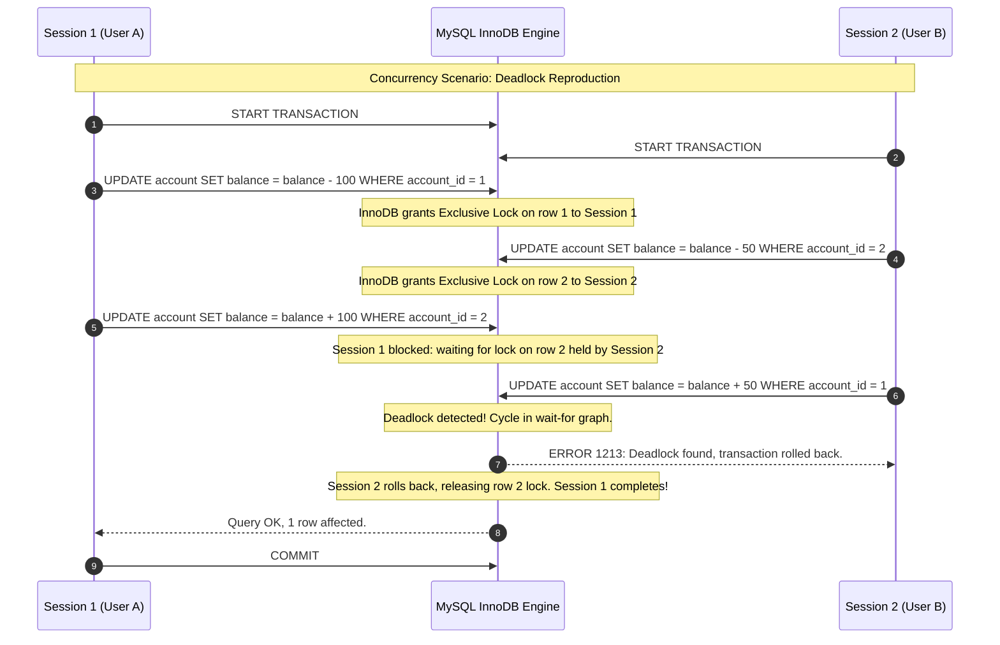

# Portfolio 3: Transactions and Concurrency Control

**Course:** MIT8103 — Advanced Database Systems  
**Student Name:** Mary Okwusogu  
**Student ID:** 301903956  
**Institution:** Miva Open University  
**Case Study Application:** BlitzFintech Core Banking & Concurrency Engine  
**Primary Database Engine:** MySQL 8.x (InnoDB Storage Engine)  
**Status:** Planned / In Progress *(Documentation and Roadmap Phase)*  

---

## 1. Executive Summary & Objectives

Portfolio 3 investigates **Transaction Management, ACID Properties, Concurrency Control, and Isolation Anomalies** within high-throughput transactional database systems. In financial environments like BlitzFintech, hundreds of concurrent users simultaneously execute balance transfers, debit operations, and status changes. Without robust concurrency controls, race conditions result in severe anomalies such as lost updates, double spending, dirty reads, and inconsistent ledger records.

### Key Objectives
1. **ACID Properties Empirical Demonstration:** Implement and prove the four pillars of transactional integrity:
   - **Atomicity:** Ensuring complex multi-account transfers either fully commit or cleanly rollback without partial state.
   - **Consistency:** Enforcing schema rules (e.g., `balance >= 0`, non-negative transaction amounts, balanced debit/credit sums).
   - **Isolation:** Controlling the visibility of uncommitted state across concurrent sessions.
   - **Durability:** Validating persistence guarantees via Write-Ahead Logging (WAL) and InnoDB redo logs.
2. **Analysis of Transaction Isolation Levels:** Empirically evaluate the four ANSI SQL / MySQL isolation levels:
   - `READ UNCOMMITTED`
   - `READ COMMITTED`
   - `REPEATABLE READ` (MySQL default)
   - `SERIALIZABLE`
3. **Concurrency Anomaly Reproduction & Mitigation:** Intentionally reproduce classic concurrency phenomena across parallel database sessions:
   - Dirty Reads
   - Non-Repeatable Reads
   - Phantom Reads
   - Lost Updates
4. **Locking Mechanisms & Deadlock Resolution:** Investigate InnoDB row-level locking (Shared `S` locks, Exclusive `X` locks, Intention locks, Next-Key locks) and simulate, capture, and resolve database deadlocks.
5. **Optimistic vs. Pessimistic Concurrency Control:** Design and compare pessimistic locking (`SELECT ... FOR UPDATE`) versus optimistic concurrency control (version timestamps / row versioning).

---

## 2. Scope & Target Financial Workloads

The concurrency control evaluation focuses on high-risk financial scenarios on BlitzFintech:

1. **Atomic Peer-to-Peer Transfer:** Debiting Account A, crediting Account B, creating transaction headers, and generating balanced ledger entries within an atomic transaction.
2. **Concurrent Double-Spend / Lost Update:** Two concurrent withdrawal requests arriving simultaneously for an account with sufficient balance for only one request.
3. **Simultaneous Multi-Account Deadlock:** Session 1 transferring funds from Account A to Account B while Session 2 simultaneously transfers funds from Account B to Account A.
4. **Phantom Row Generation in Batch Reconciliation:** Demonstrating how insert operations during an ongoing aggregation query can produce inconsistent audit totals under non-repeatable isolation levels.

---

## 3. Directory Structure (Planned Architecture)

```
portfolio-3-transactions-concurrency/
├── 01-documentation/
│   ├── transactions-concurrency-report.docx       # Planned comprehensive academic report
│   └── anomaly-matrix.md                          # Isolation anomaly reference guide
├── 02-transaction-procedures/
│   ├── 01-transfer-procedure.sql                  # Production-grade transfer stored procedure
│   └── 02-optimistic-locking-schema.sql          # Versioned table schema for optimistic locking
├── 03-concurrency-tests/
│   ├── 01-dirty-read-simulation.sql               # Multi-session dirty read test scripts
│   ├── 02-non-repeatable-read-simulation.sql      # Non-repeatable read test scripts
│   ├── 03-phantom-read-simulation.sql             # Phantom read test scripts
│   ├── 04-lost-update-simulation.sql              # Lost update reproduction & resolution
│   └── 05-deadlock-simulation.sql                 # Deadlock generation & resolution scripts
├── 04-evidence-and-logs/
│   ├── engine-innodb-status.log                   # Deadlock logs and transaction lock dumps
│   ├── session-interaction-matrix.xlsx            # Step-by-step parallel session trace
│   └── screenshot-evidence.docx                   # Screenshot exhibits of multi-session testing
└── README.md                                      # Portfolio overview (this document)
```

> **Implementation Note:** This directory currently specifies the experimental methodology and planned test harnesses. Active multi-session test scripts and deadlock logs will be recorded during implementation.

---

## 4. Planned File Inventory & Descriptions

### Documentation (`01-documentation/`)
- `transactions-concurrency-report.docx`: Comprehensive academic paper covering transaction theory, Multi-Version Concurrency Control (MVCC) mechanics, lock trees, deadlock detection algorithms, and performance implications.
- `anomaly-matrix.md`: Theoretical reference matrix mapping each ANSI isolation level against permissible and prevented phenomena.

### Transaction Procedures (`02-transaction-procedures/`)
- `01-transfer-procedure.sql`: Full stored procedure `sp_execute_transfer` featuring:
  - Account ordering (sorting account IDs before locking) to prevent circular deadlocks.
  - Pessimistic locking (`SELECT balance FROM account WHERE account_id = ... FOR UPDATE`).
  - Validation of active account status, KYC clearance, and available funds.
  - Insert of `financial_transaction` and dual `ledger_entry` records.
  - `account.balance` updates.
  - Structured `DECLARE EXIT HANDLER FOR SQLEXCEPTION` triggering automatic `ROLLBACK`.
- `02-optimistic-locking-schema.sql`: DDL adding `row_version INT UNSIGNED` to the `account` table and demonstrating conditional update logic (`WHERE account_id = :id AND row_version = :expected_version`).

### Concurrency Test Harnesses (`03-concurrency-tests/`)
- `01-dirty-read-simulation.sql`: Coordinated SQL statements across Session 1 and Session 2 under `SET TRANSACTION ISOLATION LEVEL READ UNCOMMITTED;` demonstrating Session 2 reading uncommitted balance updates.
- `02-non-repeatable-read-simulation.sql`: Testing Session 1 reading row data, Session 2 committing an update, and Session 1 re-reading altered data under `READ COMMITTED`.
- `03-phantom-read-simulation.sql`: Demonstrating range queries capturing newly inserted rows across transactions and showing how InnoDB Next-Key Locks prevent phantoms under `REPEATABLE READ`.
- `04-lost-update-simulation.sql`: Parallel read-modify-write without locking leading to overwritten funds, followed by the defensive `SELECT ... FOR UPDATE` resolution.
- `05-deadlock-simulation.sql`: Reproducible cross-dependency script inducing MySQL Error 1213: *Deadlock found when trying to get lock; try restarting transaction*.

### Evidence & Logs (`04-evidence-and-logs/`)
- `engine-innodb-status.log`: Raw output of `SHOW ENGINE INNODB STATUS;` capturing the exact `LATEST DETECTED DEADLOCK` section, lock wait states, and thread IDs.
- `session-interaction-matrix.xlsx`: Chronological timeline tracking Session 1 vs. Session 2 actions, executed SQL, lock states held, and observed outcomes.
- `screenshot-evidence.docx`: Documented screenshots showing side-by-side terminal windows running simultaneous transactions.

---

## 5. Technology Stack & Concurrency Architecture

- **DBMS Platform:** MySQL 8.x Community Server
- **Engine:** InnoDB with Multi-Version Concurrency Control (MVCC)
- **MVCC Architecture:** Read Views, Undo Logs (rollback segments), and row creation/deletion system columns (`DB_TRX_ID`, `DB_ROLL_PTR`).
- **Locking Mechanisms:**
  - Record Locks (locks on index records)
  - Gap Locks (locks on gaps between index records)
  - Next-Key Locks (Record Lock + Gap Lock combination)
- **Monitoring Tools:**
  - `performance_schema.data_locks`
  - `performance_schema.data_lock_waits`
  - `SHOW ENGINE INNODB STATUS;`
  - `sys.innodb_lock_waits` view

---

## 6. Experimental Concurrency Test Methodology



### Anomaly Comparison Matrix

| Isolation Level | Dirty Read | Non-Repeatable Read | Phantom Read | Concurrency Contention |
|---|---|---|---|---|
| `READ UNCOMMITTED` | **Occurs** | **Occurs** | **Occurs** | Lowest |
| `READ COMMITTED` | Prevented | **Occurs** | **Occurs** | Moderate |
| `REPEATABLE READ` *(MySQL Default)* | Prevented | Prevented | Prevented *(via Next-Key Locks)* | High |
| `SERIALIZABLE` | Prevented | Prevented | Prevented | Highest (Shared lock reads) |

---

## 7. Current Status & Deliverable Tracking

| Phase / Deliverable | Status | Target Completion | Evidence / Artifact |
|---|---|---|---|
| Portfolio Scope & Architectural Plan | **Completed** | Milestone 1 | `README.md` (this file) |
| Stored Procedure (`sp_execute_transfer`) | Planned | Milestone 2 | `02-transaction-procedures/` |
| Isolation Anomaly Test Suite | Planned | Milestone 3 | `03-concurrency-tests/` |
| Deadlock Simulation & Diagnostic Logs | Planned | Milestone 3 | `04-evidence-and-logs/` |
| Comparative OCC vs. PCC Benchmark | Planned | Milestone 4 | `04-evidence-and-logs/` |
| Academic Report & Evidence DOCX | Planned | Milestone 4 | `01-documentation/` |

---

## 8. Limitations & Engineering Trade-Offs

- **Deadlock Inevitability:** In high-concurrency systems, deadlocks cannot be 100% prevented by design alone. Systems must incorporate client-side retry logic with exponential backoff.
- **Pessimistic vs. Optimistic Contention:** Pessimistic locking (`FOR UPDATE`) reduces abort rates under high contention but causes lock queues and latency spikes. Optimistic locking achieves high throughput under low contention but incurs frequent transaction aborts when conflict rates rise.
- **Isolation Overhead:** Higher isolation levels (`SERIALIZABLE`) reduce throughput by replacing lock-free snapshot reads with shared locks on index records.

---

## 9. References & Standards

1. Berenson, H., Bernstein, P., Gray, J., Melton, J., O'Neil, E. and O'Neil, P. (1995). 'A Critique of ANSI SQL Isolation Levels'. *ACM SIGMOD Record*, 24(2), pp. 1–10.
2. Gray, J. and Reuter, A. (1993). *Transaction Processing: Concepts and Techniques*. San Francisco: Morgan Kaufmann.
3. Oracle Corporation (2024). *MySQL 8.0 Reference Manual: InnoDB Locking and Transaction Model*. Available at: https://dev.mysql.com/doc/refman/8.0/en/innodb-locking-transaction-model.html.
4. Kleppmann, M. (2017). *Designing Data-Intensive Applications: The Big Ideas Behind Reliable, Scalable, and Maintainable Systems*. Sebastopol, CA: O'Reilly Media.
