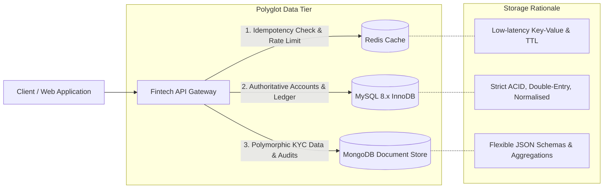

# Portfolio 4: NoSQL Databases

**Course:** MIT8103 — Advanced Database Systems  
**Student Name:** Mary Okwusogu  
**Student ID:** 301903956  
**Institution:** Miva Open University  
**Case Study Application:** BlitzFintech Polyglot Persistence Architecture  
**Primary NoSQL Platform:** MongoDB (Document Store) & Redis (In-Memory Key-Value Cache)  
**Status:** Planned / In Progress *(Documentation and Roadmap Phase)*  

---

## 1. Executive Summary & Objectives

Portfolio 4 explores **NoSQL Databases, Polyglot Persistence, Document Data Modelling, and Non-Relational Storage Paradigms**, examining how modern distributed systems augment relational engines. While MySQL InnoDB remains authoritative for BlitzFintech's transactional double-entry ledger and account balances, financial platforms generate vast volumes of polymorphic, semi-structured, and high-velocity data—such as third-party KYC verification JSON payloads, biometric metadata, session tokens, and fast notification event queues.

### Key Objectives
1. **Polyglot Persistence Design:** Architect a complementary hybrid data storage tier integrating relational MySQL with a document store (MongoDB) and in-memory key-value cache (Redis).
2. **Document-Oriented Schema Design:** Model complex, hierarchical, and polymorphic financial domain entities in JSON/BSON, addressing the fundamental trade-off of **Embedding vs. Referencing**.
3. **NoSQL Querying & Aggregation Pipelines:** Develop multi-stage MongoDB aggregation pipelines (`$match`, `$unwind`, `$group`, `$project`, `$lookup`, `$facet`) for analytical fraud detection and customer risk profiling.
4. **Indexing & Performance in Document Databases:** Implement single-field, compound, multikey (array), text, and TTL (Time-To-Live) indexes in MongoDB to optimize document retrieval and automated cache expiration.
5. **Consistency Models & CAP Theorem Evaluation:** Analyze the CAP theorem (Consistency, Availability, Partition Tolerance) and MongoDB's tunable write concerns (`w: 1`, `w: "majority"`) and read concerns (`local`, `majority`, `linearizable`).

---

## 2. Scope & Target Use Cases (BlitzFintech)

The NoSQL implementation specifically addresses data domains that are ill-suited for strict relational schemas:

1. **Third-Party KYC & Biometric Verification Responses:** Storing variable-schema JSON verification payloads returned by external identity providers (e.g., facial match scores, PEP watchlist checks, sanctions screening hits) without requiring relational schema migrations.
2. **Dynamic Audit Event Lake:** Ingesting high-velocity, semi-structured audit records where individual events contain disparate payload attributes.
3. **High-Speed Session & Idempotency Cache (Redis):** Providing microsecond sub-millisecond lookups for client idempotency keys, active authentication sessions, and rate-limiting counters.
4. **Customer Activity Timeline & Aggregations:** Aggregating customer activity, transaction categories, and spending patterns using MongoDB aggregation pipelines.

---

## 3. Directory Structure (Planned Architecture)

```
portfolio-4-nosql/
├── 01-documentation/
│   ├── nosql-architecture-report.docx             # Planned comprehensive academic report
│   └── cap-theorem-tradeoffs.md                   # Theoretical CAP & PACELC analysis
├── 02-schemas-and-models/
│   ├── kyc-verification-payload.schema.json       # JSON Schema definition for KYC payloads
│   ├── audit-event.schema.json                    # JSON Schema for semi-structured audit events
│   └── data-model-justification.md                # Embedding vs. Referencing design rationale
├── 03-mongodb-scripts/
│   ├── 01-init-collections.js                     # Collection initialization & JSON validators
│   ├── 02-create-indexes.js                       # Compound, multikey, text & TTL indexes
│   ├── 03-seed-documents.json                     # Synthetic semi-structured document dataset
│   ├── 04-aggregation-pipelines.js                # Multi-stage reporting & analytics pipelines
│   └── 05-crud-operations.js                      # Atomic update operations ($set, $push, $inc)
├── 04-redis-cache/
│   ├── 01-idempotency-cache.redis                 # Redis CLI scripts for idempotency key caching
│   └── 02-rate-limiting.redis                     # Rate limiting & token bucket simulation
├── 05-benchmarks-and-evidence/
│   ├── relational-vs-nosql-benchmark.xlsx         # Performance & storage footprint comparison
│   └── screenshot-evidence.docx                   # Documented screenshots of Compass & mongosh
└── README.md                                      # Portfolio overview (this document)
```

> **Implementation Note:** This directory is currently initialized with the architectural specifications, schemas, and pipeline blueprints. MongoDB and Redis scripts will be executed and validated during the active lab phase.

---

## 4. Planned File Inventory & Descriptions

### Documentation (`01-documentation/`)
- `nosql-architecture-report.docx`: Academic report comparing relational vs. NoSQL paradigms, polyglot persistence architecture, BSON serialization, WiredTiger storage engine internals, and consistency trade-offs.
- `cap-theorem-tradeoffs.md`: In-depth analysis of MongoDB under network partitions, evaluating CP (Consistency/Partition Tolerance) defaults versus AP configurations.

### Schemas and Models (`02-schemas-and-models/`)
- `kyc-verification-payload.schema.json`: Formal JSON Schema with validation rules enforcing mandatory document IDs while allowing variable third-party verification attributes.
- `audit-event.schema.json`: Schema specification for flexible event logging.
- `data-model-justification.md`: Detailed rationale explaining when documents are embedded (e.g., identity verification checks within a KYC case) versus referenced via `ObjectId` (e.g., referencing relational `customer_id`).

### MongoDB Implementation (`03-mongodb-scripts/`)
- `01-init-collections.js`: Database script configuring collections (`kyc_verification_events`, `audit_events`, `customer_profiles`) with strict `$jsonSchema` validators.
- `02-create-indexes.js`: Script generating:
  - Compound indexes: `{ customer_id: 1, verified_at: -1 }`
  - Multikey indexes on array fields: `{ "sanction_hits.screening_category": 1 }`
  - Text search indexes: `{ "notes": "text", "applicant_name": "text" }`
  - TTL indexes: Automatically purging expired session tokens after 86,400 seconds.
- `03-seed-documents.json`: Rich synthetic document dataset representing 50+ detailed verification payloads.
- `04-aggregation-pipelines.js`: Production-grade analytical queries:
  - Pipeline 1: Aggregating verification rejection rates categorized by document type.
  - Pipeline 2: High-risk customer profiling identifying multi-category sanction hits.
  - Pipeline 3: Monthly volume aggregation by geographic country code.
- `05-crud-operations.js`: Demonstrating atomic document updates using operators like `$set`, `$addToSet`, `$inc`, and array filters.

### Redis Cache (`04-redis-cache/`)
- `01-idempotency-cache.redis`: Implementation of Redis `SET key value NX EX 300` for 5-minute atomic idempotency locks.
- `02-rate-limiting.redis`: Token bucket and sliding-window rate limiting scripts protecting transaction initiation endpoints.

### Benchmarks & Evidence (`05-benchmarks-and-evidence/`)
- `relational-vs-nosql-benchmark.xlsx`: Comparative matrix measuring query latency, storage size per record, schema flexibility score, and write throughput between MySQL and MongoDB.
- `screenshot-evidence.docx`: Documented screenshot exhibits capturing MongoDB Compass visual query builder, `mongosh` terminal commands, and Redis CLI responses.

---

## 5. Technology Stack & Architecture

- **Document Database:** MongoDB Community Edition 7.x / 8.x
- **Storage Engine:** WiredTiger (B-Tree indexes, snappy compression, document-level concurrency)
- **Query Tools:** `mongosh` (MongoDB Shell) and MongoDB Compass GUI
- **In-Memory Store:** Redis 7.x (Strings, Hashes, Sets, Sorted Sets)
- **Interfacing Language:** JavaScript / JSON / BSON
- **Relational Anchor:** MySQL 8.x InnoDB (authoritative for double-entry financial balances)

---

## 6. Architectural Data Flow: Polyglot Persistence



---

## 7. Current Status & Deliverable Tracking

| Phase / Deliverable | Status | Target Completion | Evidence / Artifact |
|---|---|---|---|
| NoSQL Architecture & Scope Plan | **Completed** | Milestone 1 | `README.md` (this file) |
| JSON Schema Specifications | Planned | Milestone 2 | `02-schemas-and-models/` |
| MongoDB Collection & Index Scripts | Planned | Milestone 3 | `03-mongodb-scripts/` |
| Multi-Stage Aggregation Pipelines | Planned | Milestone 3 | `03-mongodb-scripts/` |
| Redis Idempotency Cache Scripts | Planned | Milestone 4 | `04-redis-cache/` |
| Comparative Benchmark & Evidence DOCX | Planned | Milestone 4 | `01-documentation/` |

---

## 8. Limitations & Engineering Trade-Offs

- **No Multi-Document Foreign Keys:** Unlike relational databases, MongoDB does not enforce declarative foreign-key constraints across collections. Application logic or `$lookup` aggregation stages are required to verify referential integrity.
- **Controlled Duplication (Embedding):** Embedding child records (e.g., identity verification hits inside a KYC document) accelerates read operations by eliminating joins, but risks unbounded document growth (exceeding MongoDB's 16MB document size limit) if arrays grow indefinitely.
- **Eventual Consistency:** When data flows asynchronously from the primary relational engine to the NoSQL reporting store, analytical queries operate on slightly stale data (eventual consistency window).

---

## 9. References & Standards

1. MongoDB, Inc. (2024). *MongoDB Manual: Data Modeling Concepts and Aggregation Pipeline*. Available at: https://www.mongodb.com/docs/manual/.
2. Redis Ltd. (2024). *Redis Documentation: Data Structures and Patterns*. Available at: https://redis.io/docs/.
3. Fowler, M. and Sadalage, P. J. (2012). *NoSQL Distilled: A Brief Guide to the Emerging World of Polyglot Persistence*. Upper Saddle River, NJ: Addison-Wesley.
4. Brewer, E. (2012). 'CAP twelve years later: How the "rules" have changed'. *Computer*, 45(2), pp. 23–29.
