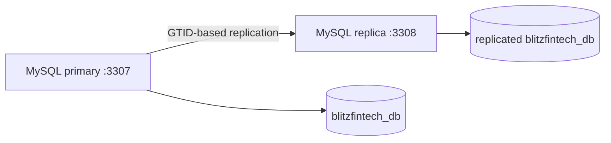
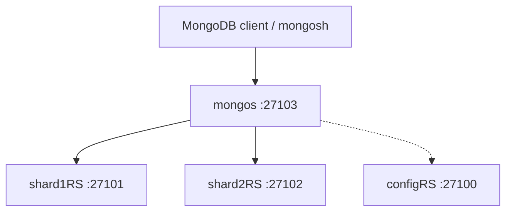

# MIT-8103 Portfolio 5 — Distributed and Cloud Databases

**Student:** Mary Okwusogu  
**Student ID:** 301903956  
**Institution:** Miva Open University  
**Course:** MIT-8103 Advanced Database Systems  
**Case study:** BlitzFintech  
**Implementation:** MySQL GTID replication with tested manual failover/failback, MongoDB Atlas replica-set assessment, and local MongoDB sharding

## 1. Executive summary

This portfolio demonstrates distributed database concepts using the same BlitzFintech case study developed in Portfolios 1–4. It combines (1) a self-managed MySQL 8.0 primary–replica configuration for relational financial data, (2) an examination of the existing MongoDB Atlas replica-set deployment for document workloads, and (3) a local MongoDB 8.0 sharded cluster for transaction-event documents. The work distinguishes tested behavior from architectural recommendations. The sharding experiment uses **synthetic, non-reconciled demonstration records**, not verified financial transactions.

### Objectives

- Configure and verify MySQL primary–replica replication using GTIDs.
- Demonstrate controlled manual failover, preserve post-promotion writes, reconcile GTIDs, and restore the original replication topology.
- Assess the replica-set topology of the existing MongoDB Atlas environment.
- Implement a local, two-shard MongoDB cluster and shard a Portfolio 4-compatible collection.
- Demonstrate physical document distribution and targeted versus scatter-gather query routing.
- Discuss availability, consistency, recovery, cloud DBaaS options, and limitations without presenting untested scenarios as completed experiments.

## 2. BlitzFintech context and data architecture

BlitzFintech manages customer onboarding and KYC, accounts, deposits, withdrawals, transfers, transaction approvals, ledger entries, and audit information. Earlier portfolios use MySQL for structured relational records and MongoDB for flexible documents such as KYC profiles, compliance events, and transaction events.

**Relational system:** MySQL `blitzfintech_db` on the local Windows environment.  
**Atlas document system:** MongoDB Atlas database `blitzfintech_nosql` (existing Portfolio 4 document collections).  
**Local sharding lab:** MongoDB database `blitzfintech_shard`, collection `transaction_events`.

The local sharding lab is **separate from Atlas and MySQL**. It does not implement automatic data synchronization between the three systems.

## 3. Environment and topology

### 3.1 MySQL primary–replica lab

| Component | Configuration |
|---|---|
| Primary | Windows service `MySQLMiva80`, TCP port `3307`, server ID `26` |
| Replica | Windows service `MySQLBlitzReplica`, TCP port `3308`, server ID `27` |
| Database | `blitzfintech_db` |
| Replication positioning | GTID-based, `SOURCE_AUTO_POSITION=1` |
| Binary logging | Row-based |
| Replica protection | `read_only=ON`, `super_read_only=ON` |
| Other local service | `MySQL97` on port `3306`; outside this exercise |



### 3.2 MongoDB Atlas replica-set assessment

The existing MongoDB Atlas M0 deployment runs MongoDB 8.0.34 on AWS in Paris. Its replica set, `atlas-8bktgz-shard-0`, was observed to have one PRIMARY and two SECONDARY members. The `rs.status()` assessment confirmed member health. This is an **assessment of Atlas-managed replication**, not a self-configured Atlas sharded cluster. The M0 deployment was not used to create shards.

### 3.3 Local MongoDB sharded cluster

| Role | Replica-set name | Local address |
|---|---|---|
| Config server | `configRS` | `127.0.0.1:27100` |
| Data shard 1 | `shard1RS` | `127.0.0.1:27101` |
| Data shard 2 | `shard2RS` | `127.0.0.1:27102` |
| Query router | `mongos` | `127.0.0.1:27103` |



The local cluster uses **single-member replica sets** and a **single config server**. This topology is sufficient for a controlled teaching demonstration but lacks production redundancy. Services bind to loopback addresses; local lab access controls and operational hardening were not validated as production-ready.

## 4. MySQL replication implementation and verification

### 4.1 Configuration

The primary and replica were configured as distinct Windows MySQL services, with unique server IDs and ports. GTID-compatible settings and row-based binary logging were used. Replication was configured with source auto-positioning so the replica can identify transactions by GTID rather than relying solely on file/position coordinates.

**Do not run setup commands against an existing database without checking the live server configuration and backups first.** Credentials, replication passwords, and private connection strings must not be committed to GitHub.

### 4.2 Verified results

- `Replica_IO_Running = Yes` and `Replica_SQL_Running = Yes`.
- `Seconds_Behind_Source = 0` at the time of verification.
- No replication errors reported in the verified status.
- The original 15 BlitzFintech tables showed matching row counts between primary and replica.
- Account balance and transaction aggregates were compared.
- Test-table CREATE, INSERT, and UPDATE operations propagated from primary to replica.
- Direct writes to the replica were rejected by read-only protections.

These observations establish successful replication **at the test points**; they do not establish zero lag under all workloads or guaranteed zero data loss in a failure.

### 4.3 Verification queries (illustrative)

```sql
-- Execute on the replica:
SHOW REPLICA STATUS\G
SHOW VARIABLES WHERE Variable_name IN ('read_only', 'super_read_only');

-- Execute on each server to compare relevant tables:
SELECT table_name, table_rows
FROM information_schema.tables
WHERE table_schema = 'blitzfintech_db'
ORDER BY table_name;
```

**Note:** `information_schema.tables.table_rows` can be approximate for InnoDB; use exact `COUNT(*)` per table when documenting definitive count parity. Do not confuse the illustrative queries above with a preserved transcript of the exact commands previously executed.

### 4.4 Manual failover, transaction reconciliation, and failback (completed 1 November 2026)

The original primary was `MySQLMiva80` on port `3307` (server ID `26`); the replica was `MySQLBlitzReplica` on port `3308` (server ID `27`). Both instances ran on **the same Windows host**, so this was a controlled role-change demonstration rather than a test of host-level disaster resilience.

**Procedure and observed evidence:**

1. Verified source/replica synchronization and backups, restricted writes during the role change, stopped replication on `3308`, and manually promoted it to accept writes.
2. Created `blitzfintech_db.failover_validation` on the promoted server and inserted the record `PORTFOLIO5-FAILOVER-001` (`validation_id=1`, timestamp `2026-11-01 16:40:16`). This established that the promoted instance accepted a write.
3. Before failback, created the logical backup `blitzfintech_pre_failback_3307.sql` from the original primary. Its observed size was 498,980 bytes; the file contained 16 `CREATE TABLE` statements. This is **not** proof of a successful restore.
4. Identified the promoted replica's local GTID sequence `f88c40eb-d3e8-11f1-b9e6-28d0ead63f2a:1-7`. Transactions `1-5` were earlier administrative changes and were **not** replayed on `3307`. Only the failover demonstration transactions `6-7` were extracted from `replica-bin.000005` using `mysqlbinlog --include-gtids` and replayed on `3307` with the MySQL interactive client's `SOURCE` command.
5. Verified on `3307` that the failover record existed and `GTID_SUBSET('f88c40eb-d3e8-11f1-b9e6-28d0ead63f2a:6-7', @@GLOBAL.gtid_executed)` returned `1`. The executed GTID set included `a1e2942f-cb30-11f1-b2ba-28d0ead63f2a:1-8` and `f88c40eb-d3e8-11f1-b9e6-28d0ead63f2a:6-7`.
6. Restarted GTID auto-position replication from `3307` to `3308`. `SHOW REPLICA STATUS` on `3308` reported both I/O and SQL threads `Yes`, `Seconds_Behind_Source=0`, `Auto_Position=1`, and error numbers `0`. The relay-log status indicated the replica was waiting for further updates.
7. Confirmed matching counts for `customer` (100), `account` (100), `financial_transaction` (509), `ledger_entry` (710), `audit_log` (509), and `failover_validation` (1), and confirmed the failover record on both servers.
8. Restored `3307` to writable mode (`read_only=0`, `super_read_only=0`) while keeping `3308` read-only (`read_only=1`, `super_read_only=1`).
9. Inserted `PORTFOLIO5-FAILBACK-001` on `3307`. The record appeared automatically on `3308` with `validation_id=2`, timestamp `2026-11-01 18:07:30`. The replica's primary-origin GTID sequence advanced to `a1e2942f-cb30-11f1-b2ba-28d0ead63f2a:1-9`, with both replication threads running, lag `0`, and no reported replication errors.

**Final verified topology:** `3307` is the writable primary; `3308` is the read-only replica; GTID auto-position replication is running. The demonstrated recovery is **manual**, not automatic.

**GTID caveat:** The replica retains administrative GTIDs `f88c40eb-...:1-5` absent from the original primary. They were intentionally excluded from reconciliation; the GTID histories are therefore not identical. Their operational effects should be assessed before another promotion or topology change. Matching selected row counts and successful test-record replication do not prove full row-by-row equivalence.

**Recovery limitations:** No host-loss, automated failover, RTO/RPO measurement, point-in-time recovery, or independently validated restore was demonstrated. This local asynchronous topology does not guarantee zero data loss during an unplanned failure.

### 4.5 Key verification SQL

```sql
-- Run on the replica (port 3308) to check replication threads and errors:
SHOW REPLICA STATUS;

-- Run on each instance to verify the current server role:
SELECT @@port AS mysql_port,
       @@GLOBAL.read_only AS read_only_status,
       @@GLOBAL.super_read_only AS super_read_only_status,
       @@GLOBAL.gtid_executed AS executed_gtids;

-- Verify both demonstration records on each instance:
SELECT validation_id, test_reference, test_description, created_at
FROM blitzfintech_db.failover_validation
WHERE test_reference IN ('PORTFOLIO5-FAILOVER-001',
                         'PORTFOLIO5-FAILBACK-001')
ORDER BY validation_id;
```

## 5. MongoDB Atlas replication assessment

The Atlas replica-set inspection used `rs.status()` to examine members and their roles. The deployment contained one PRIMARY and two SECONDARY nodes and was healthy when checked. Atlas manages its underlying replica-set operations; the exercise did not manually reconfigure the Atlas cluster or conduct an Atlas failover experiment.

A `listShards` attempt returned `CommandNotFound` because the session was connected to a replica set rather than a `mongos` sharded router. The decision was therefore to **retain Atlas unchanged** and conduct the sharding experiment locally.

## 6. MongoDB sharding implementation

### 6.1 Collection design and validation

The local `blitzfintech_shard.transaction_events` collection was created **through `mongos`**, preserving the required fields and BSON types from the Portfolio 4 Atlas `transaction_events` collection:

| Required field | Type / restriction |
|---|---|
| `eventId` | string |
| `transactionId` | BSON long |
| `transactionReference` | string |
| `accountId` | BSON long |
| `eventType` | DEPOSIT, WITHDRAWAL, TRANSFER, REVERSAL |
| `amount` | BSON decimal |
| `currency` | NGN |
| `transactionStatus` | PENDING, POSTED, FAILED, REVERSED |
| `createdAt` | BSON date |

Optional fields include `entryType` (DEBIT or CREDIT) and `context` (object). Validation was configured with `validationLevel: 'strict'` and `validationAction: 'error'`.

An initial attempt to create the collection and index while connected directly to `configRS` did **not** make the collection visible through `mongos`. The issue was corrected by connecting to port `27103` and creating the collection through the router. Config-server-local test objects were not part of the sharded collection.

### 6.2 Shard-key configuration

```javascript
// Run through mongos on 127.0.0.1:27103
use blitzfintech_shard

db.transaction_events.createIndex({ transactionId: 'hashed' });
sh.shardCollection('blitzfintech_shard.transaction_events',
                   { transactionId: 'hashed' });
sh.status();
```

`sh.shardCollection()` returned `ok: 1`. The status output confirmed a hashed `transactionId` shard key and one chunk assigned to each of `shard1RS` and `shard2RS`. A hashed shard key supports distributed equality lookups but does **not** itself guarantee unique `transactionId` values or optimal routing for other query fields.

### 6.3 Synthetic data load and distribution

The lab inserted 1,000 **synthetic** transaction-event documents with schema-compliant `NumberLong` transaction/account IDs, `NumberDecimal` NGN amounts, transaction references, and `context.synthetic: true`. These records are explicitly **not reconciled with MySQL**.

`db.transaction_events.getShardDistribution()` returned:

| Metric | shard1RS | shard2RS | Total |
|---|---:|---:|---:|
| Documents | 520 | 480 | 1,000 |
| Share of documents | 52% | 48% | 100% |
| Reported data | 195 KiB | 179 KiB | ~375 KiB |
| Chunks | 1 | 1 | 2 |

The two-shard distribution is approximately balanced for this small demonstration; it is not a throughput or scaling benchmark.

## 7. Shard-aware query routing experiment

The following queries were run through `mongos` using `explain('executionStats')`.

### Test A — Targeted query using the shard key

```javascript
db.transaction_events.find({
  transactionId: NumberLong('100')
}).explain('executionStats');
```

Observed: `SINGLE_SHARD` targeting `shard2RS`; `IXSCAN` using `transactionId_hashed`; one index key and one document examined; one document returned; reported execution time 3 ms.

### Test B — Query without the shard key

```javascript
db.transaction_events.find({
  transactionStatus: 'POSTED'
}).explain('executionStats');
```

Observed: `SHARD_MERGE` across `shard1RS` and `shard2RS`; `COLLSCAN` on each; 520 and 480 documents examined respectively; 1,000 returned; reported execution time 3 ms.

| Metric | Test A | Test B |
|---|---|---|
| Routing | SINGLE_SHARD | SHARD_MERGE |
| Shards involved | shard2RS | shard1RS and shard2RS |
| Access path | IXSCAN | COLLSCAN |
| Keys examined | 1 | 0 |
| Documents examined | 1 | 1,000 |
| Documents returned | 1 | 1,000 |
| Reported time | 3 ms | 3 ms |

**Interpretation:** The experiment demonstrates different routing patterns and work performed, **not** a measured latency improvement. Both executions reported the same elapsed time in this small local test. A secondary index on `transactionStatus` was not part of the required completed work.

## 8. Availability, consistency, and cloud architecture discussion

### 8.1 Replication and consistency

MySQL asynchronous replication can provide read scaling and an additional copy of the data, but replica lag and stale reads remain possible. For financial balances, posting and other consistency-sensitive operations should be directed to the authoritative transactional database unless the application explicitly accounts for replica freshness. The test observed zero lag at a particular time; it did not establish synchronous durability.

MongoDB Atlas replica-set replication provides managed redundancy and primary/secondary roles. Application consistency depends on write concern, read concern, read preference, and failure conditions; this portfolio did not measure failover behavior.

MongoDB sharding distributes a collection across multiple shards. **Sharding is not the same as replication**: the local demonstration's two shards each had only one data-bearing member, so it did not provide redundant copies of each shard's data.

### 8.2 Cloud DBaaS alternatives (conceptual only)

Managed services such as Amazon RDS and Amazon Aurora can reduce operational responsibility for backups, patching, monitoring, and supported high-availability configurations. Choosing between self-managed MySQL, managed relational databases, and MongoDB Atlas requires evaluation of availability requirements, cost, transaction semantics, scaling patterns, recovery objectives, and operational skills. **No new AWS RDS or Aurora deployment was performed as part of the verified Portfolio 5 lab.**

### 8.3 Disaster recovery and failover scope

A controlled **manual MySQL failover and failback** was completed, including reconciliation of post-promotion GTIDs and verification of a new post-failback write reaching the replica (Section 4.4). Logical SQL backup files were generated, but the pre-failback dump was not independently test-restored. Automatic failover, RTO/RPO measurement, multi-region recovery, full host-failure testing, and split-brain testing were **not performed**.

## 9. Security and operational limitations

- The MongoDB sharding lab is loopback-only and intended for local study; single-member shard replica sets and the single config server are not production HA configurations.
- Synthetic transaction events must not be represented as reconciled MySQL transaction records.
- No automated MySQL-to-MongoDB change-data-capture pipeline was implemented.
- The hashed shard key supports point routing but does not remove the need for secondary indexes for other query patterns.
- Backup files may contain customer or account information; review them for sensitive data **before** staging or pushing to a public GitHub repository. Do not commit passwords, credentials, connection strings, or real customer data.
- The sharding and replication observations reflect the test environment and time, not a guarantee of production performance or resilience.

## 10. Evidence inventory and repository structure

The portfolio directory in the submitted archive is:

```text
Okwusogu_Mary_301903956_portfolio_5_distributed_cloud/
├── Okwusogu_Mary_301903956_README.md
├── Okwusogu_Mary_301903956_MySQL_Replica_Setup_Evidence.docx
├── Okwusogu_Mary_301903956_MySQL_Failover_Evidence.docx
├── Okwusogu_Mary_301903956_MongoDB_ Replica_Evidence.docx
├── Okwusogu_Mary_301903956_MongoDB_ Sharding_Installation_Evidence.docx
└── 06_failover_disaster_recovery/
    ├── backups/  # Included in shared ZIP; check confidentiality and Git tracking
    │   ├── blitzfintech_gtid_replication_backup.sql
    │   ├── blitzfintech_pre_replication.sql
    │   ├── blitzfintech_pre_failback_3307.sql
    │   └── blitzfintech_failover_reconciliation.sql
    └── github_evidence/
```

The backup and reconciliation filenames above were observed during the exercise; verify their current local presence and Git tracking before submission. The evidence DOCX files are listed because they were observed in the repository folder; their **contents require matching to individual claims** during final assessment. Before submission, confirm that screenshots and logs support each specific claim above, especially `SHOW REPLICA STATUS`, Atlas `rs.status()`, local `sh.status()`, `getShardDistribution()`, and both query execution plans. Do not add nonexistent evidence filenames.

**Final evidence verification:** Screenshots of the two MongoDB explain plans and shard distribution; MySQL pre-promotion and post-promotion GTIDs; failover and failback validation rows; final read-only settings; `SHOW REPLICA STATUS` after failback; and the backup/reconciliation file metadata. If stored in GitHub, use clear filenames and refer to the actual committed paths.

## 11. Completion status

| Deliverable | Status |
|---|---|
| MySQL GTID-based primary–replica setup | Completed and verified |
| MySQL replica health and consistency checks | Completed and verified |
| Controlled manual MySQL failover and promoted-replica write | Completed and verified |
| Failover GTID reconciliation (`6-7`) | Completed and verified |
| Manual failback to port 3307 and post-failback replication test | Completed and verified |
| MongoDB Atlas replica-set inspection | Completed |
| Local MongoDB sharded cluster setup | Completed |
| Portfolio 4-compatible transaction-event collection | Completed |
| Hashed sharding and two-shard distribution | Completed and verified |
| Single-shard vs scatter-gather query plans | Completed and verified |
| Automatic failover and recovery-time test | Not performed; outside executed scope |
| Independent restore test of pre-failback SQL dump | Not performed |
| MySQL Group Replication / Docker cluster | Not implemented |
| MySQL table partitioning | Not implemented |
| New AWS Aurora/RDS deployment | Not implemented |
| README and evidence documentation | Evidence files included in the submitted archive; GitHub commit reported completed by student, not independently verified from this ZIP |

## 12. Conclusion

The BlitzFintech Portfolio 5 laboratory demonstrates **MySQL GTID replication with controlled manual failover and failback** and **MongoDB sharding** for distributing synthetic document workloads. Verification showed healthy MySQL replication, an existing Atlas replica-set topology, approximately balanced distribution of 1,000 documents over two local shards, and different execution paths for shard-key and non-shard-key queries. The completed MySQL exercise verified a promoted-replica write, selective GTID reconciliation, restoration of the original writable primary, and successful post-failback replication. It also illustrates why replication, sharding, failover, and disaster recovery must be evaluated separately. The local topology is an educational proof of concept, not a production-ready high-availability architecture.

## 13. References

- MongoDB Documentation — Sharding: https://www.mongodb.com/docs/manual/sharding/
- MongoDB Documentation — Shard Keys: https://www.mongodb.com/docs/manual/core/sharding-shard-key/
- MongoDB Documentation — Explain Results: https://www.mongodb.com/docs/manual/reference/explain-results/
- MySQL 8.0 Reference Manual — Replication: https://dev.mysql.com/doc/refman/8.0/en/replication.html
- Amazon RDS Documentation: https://docs.aws.amazon.com/AmazonRDS/latest/UserGuide/Welcome.html
- Amazon Aurora Documentation: https://docs.aws.amazon.com/AmazonRDS/latest/AuroraUserGuide/CHAP_AuroraOverview.html
