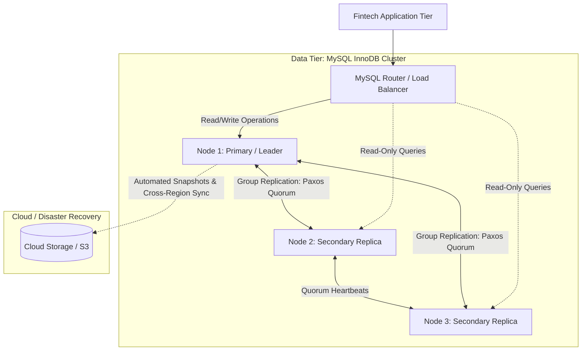

# Portfolio 5: Distributed and Cloud Databases

**Course:** MIT8103 — Advanced Database Systems  
**Student Name:** Mary Okwusogu  
**Student ID:** 301903956  
**Institution:** Miva Open University  
**Case Study Application:** BlitzFintech Globally Distributed & High-Availability Data Tier  
**Target Architectures:** MySQL Group Replication, Horizontal Partitioning (Sharding), and Cloud DBaaS (AWS Aurora / RDS)  
**Status:** Planned / In Progress *(Documentation and Roadmap Phase)*  

---

## 1. Executive Summary & Objectives

Portfolio 5 investigates **Distributed Database Systems, Cloud Architectures (DBaaS), Horizontal Scaling, High Availability (HA), and Disaster Recovery (DR)**, addressing the operational demands of scaling BlitzFintech internationally. Single-node database instances present critical single points of failure (SPOF) and vertical hardware scaling limits. Distributed database topologies provide elasticity, continuous uptime, geographical proximity for low-latency queries, and fault-tolerant failover.

### Key Objectives
1. **High Availability & Replication Topologies:** Design and evaluate primary-replica (asynchronous and semi-synchronous) and multi-primary topologies (MySQL Group Replication based on the Paxos-variant Raft/MGR consensus protocol).
2. **Horizontal Partitioning & Sharding:** Implement table partitioning strategies (Range, Hash, List) on high-cardinality tables (`financial_transaction`, `ledger_entry`, `audit_log`) to distribute I/O bottlenecks across storage tiers.
3. **Cloud-Native Database-as-a-Service (DBaaS):** Compare on-premises self-managed clustering against cloud-managed database services (e.g., AWS Aurora MySQL, AWS RDS Multi-AZ, Azure Database for MySQL), evaluating automated storage scaling, compute separation, and global read replicas.
4. **Distributed Consensus, Failover & Split-Brain Prevention:** Demonstrate automated cluster failover, quorum mechanisms, split-brain resolution, and compute Recovery Time Objective (RTO) and Recovery Point Objective (RPO).
5. **Distributed Transaction Integrity:** Examine the challenges of cross-shard operations, comparing Two-Phase Commit (2PC) with asynchronous Saga orchestration patterns.

---

## 2. Scope & Target Distributed Scenarios

The distributed database study examines critical enterprise architectural requirements for BlitzFintech:

1. **Active-Standby High Availability with Automatic Failover:** Simulating primary database node failure and measuring failover time and data loss boundaries (RTO < 30 seconds, RPO ≈ 0).
2. **Read Scaling via Asynchronous/Semi-Synchronous Read Replicas:** Offloading heavy customer reporting queries (from Portfolio 2) to geographically distributed read-only replica nodes.
3. **Temporal & Geographic Sharding of Financial Ledgers:** Partitioning `financial_transaction` and `ledger_entry` by calendar year and regional operational routing code.
4. **Disaster Recovery Strategy:** Designing multi-region automated backup snapshots, continuous point-in-time recovery (PITR), and cross-region replication.

---

## 3. Directory Structure (Planned Architecture)

```
portfolio-5-distributed-cloud/
├── 01-documentation/
│   ├── distributed-cloud-report.docx              # Planned comprehensive academic report
│   ├── ha-dr-strategy.md                          # High availability, RTO/RPO & disaster recovery plan
│   └── cloud-dbaas-comparison.md                  # Comparative evaluation: AWS Aurora vs. Self-Hosted
├── 02-cluster-configuration/
│   ├── docker-compose-cluster.yml                 # Multi-node MySQL Group Replication container cluster
│   ├── primary-node.cnf                           # MySQL configuration for primary node (GTID, binary log)
│   ├── replica-node.cnf                           # MySQL configuration for replica node
│   └── replication-setup.sql                      # SQL commands configuring replication channels
├── 03-partitioning-and-sharding/
│   ├── 01-table-partitioning.sql                  # DDL scripts implementing RANGE & HASH partitioning
│   └── 02-partition-pruning-tests.sql             # EXPLAIN queries validating partition pruning
├── 04-failover-and-benchmarks/
│   ├── failover-simulation.sh                     # Automated chaos script testing node termination
│   ├── failover-metrics.xlsx                      # Measured failover latency, RTO, and RPO log
│   └── screenshot-evidence.docx                   # Screenshot exhibits of cluster status & AWS console
└── README.md                                      # Portfolio overview (this document)
```

> **Implementation Note:** This directory is currently initialized with the architectural designs, partitioning blueprints, and cluster specifications. Multi-node container scripts and cloud configuration artifacts will be finalized during the distributed laboratory phase.

---

## 4. Planned File Inventory & Descriptions

### Documentation (`01-documentation/`)
- `distributed-cloud-report.docx`: Detailed academic report evaluating shared-nothing architectures, consensus algorithms (Paxos/Raft), distributed transactions (CAP/PACELC), cloud database economics, and disaster recovery architectures.
- `ha-dr-strategy.md`: Disaster recovery runbook detailing snapshot schedules, RTO/RPO targets, cross-region replication lag thresholds, and incident escalation workflows.
- `cloud-dbaas-comparison.md`: Rigorous technical and operational comparison between self-managed MySQL on EC2/Bare-Metal versus AWS Aurora Serverless and Google Cloud Spanner.

### Cluster Configuration (`02-cluster-configuration/`)
- `docker-compose-cluster.yml`: Docker Compose file orchestrating a local 3-node distributed MySQL 8.x cluster with network bridging and healthcheck probes.
- `primary-node.cnf` & `replica-node.cnf`: Optimized MySQL server configuration files enabling Global Transaction Identifiers (`GTID_MODE=ON`), `ENFORCE_GTID_CONSISTENCY=ON`, binary logging in row format (`BINLOG_FORMAT=ROW`), and semi-synchronous replication plugins.
- `replication-setup.sql`: SQL scripts establishing replication user accounts (`REPLICATION SLAVE`), configuring `CHANGE REPLICATION SOURCE TO`, and launching replication worker threads.

### Partitioning & Sharding (`03-partitioning-and-sharding/`)
- `01-table-partitioning.sql`: DDL implementing:
  - Range Partitioning on `ledger_entry` by `created_at` timestamp (quarterly partitions).
  - Hash/Key Partitioning on `financial_transaction` across account hash buckets for horizontal I/O distribution.
- `02-partition-pruning-tests.sql`: Verification queries demonstrating **Partition Pruning**—proving that queries filtering by date inspect only the targeted partition rather than scanning the entire table.

### Failover Testing & Evidence (`04-failover-and-benchmarks/`)
- `failover-simulation.sh`: Bash/PowerShell script terminating the active primary node, monitoring replica promotion via `mysqlrouter` or orchestrator, and logging service downtime.
- `failover-metrics.xlsx`: Quantitative log recording cluster failover duration, connection reconnection latency, and replication lag in milliseconds under load.
- `screenshot-evidence.docx`: Documented screenshot exhibits showing cluster topology dashboards, terminal replication status (`SHOW REPLICA STATUS\G`), and cloud management consoles.

---

## 5. Technology Stack & Distributed Tooling

- **Database Engine:** MySQL Community Server 8.x with InnoDB
- **Distributed Topologies:**
  - Asynchronous & Semi-Synchronous Primary-Replica
  - MySQL Group Replication (MGR) / InnoDB Cluster
- **High-Availability Routing:** MySQL Router / HAProxy
- **Containerized Orchestration:** Docker & Docker Compose
- **Cloud Reference Platforms:** AWS RDS Multi-AZ, AWS Aurora MySQL (Storage-compute decoupling architecture)
- **Monitoring Tools:** Prometheus, Grafana, and MySQL `replication_group_members` performance tables

---

## 6. High-Availability Distributed Architecture



---

## 7. Current Status & Deliverable Tracking

| Phase / Deliverable | Status | Target Completion | Evidence / Artifact |
|---|---|---|---|
| Distributed Architecture Scope Plan | **Completed** | Milestone 1 | `README.md` (this file) |
| Multi-Node Cluster Configuration | Planned | Milestone 2 | `02-cluster-configuration/` |
| Table Partitioning & Pruning Tests | Planned | Milestone 3 | `03-partitioning-and-sharding/` |
| Chaos Failover Simulation Script | Planned | Milestone 3 | `04-failover-and-benchmarks/` |
| Cloud DBaaS Evaluation & RTO/RPO Matrix | Planned | Milestone 4 | `01-documentation/` |
| Formal Academic Report & Evidence DOCX | Planned | Milestone 4 | `01-documentation/` |

---

## 8. Limitations & Engineering Trade-Offs

- **Replication Lag & Stale Reads:** Asynchronous replication allows read replicas to fall behind the primary under heavy write bursts, presenting users with slightly outdated account balances if queries are improperly routed.
- **Partitioning Constraints:** In MySQL InnoDB, all columns used in a table's partitioning expression must be part of every unique key (including the primary key), which restricts arbitrary global uniqueness constraints.
- **Distributed Two-Phase Commit Latency:** Synchronous distributed transactions across geographically separated nodes incur substantial round-trip network latency (governed by the speed of light) and lock contention.

---

## 9. References & Standards

1. Özsu, M. T. and Valduriez, P. (2020). *Principles of Distributed Database Systems*. 4th edn. Cham: Springer.
2. Oracle Corporation (2024). *MySQL 8.0 Reference Manual: Group Replication and Partitioning*. Available at: https://dev.mysql.com/doc/refman/8.0/en/group-replication.html.
3. Verbitski, A. et al. (2017). 'Amazon Aurora: Design Considerations for High Throughput Cloud-Native Relational Databases'. In: *Proceedings of the 2017 ACM International Conference on Management of Data (SIGMOD '17)*. Chicago, IL, pp. 1041–1052.
4. Kleppmann, M. (2017). *Designing Data-Intensive Applications*. Sebastopol, CA: O'Reilly Media.
